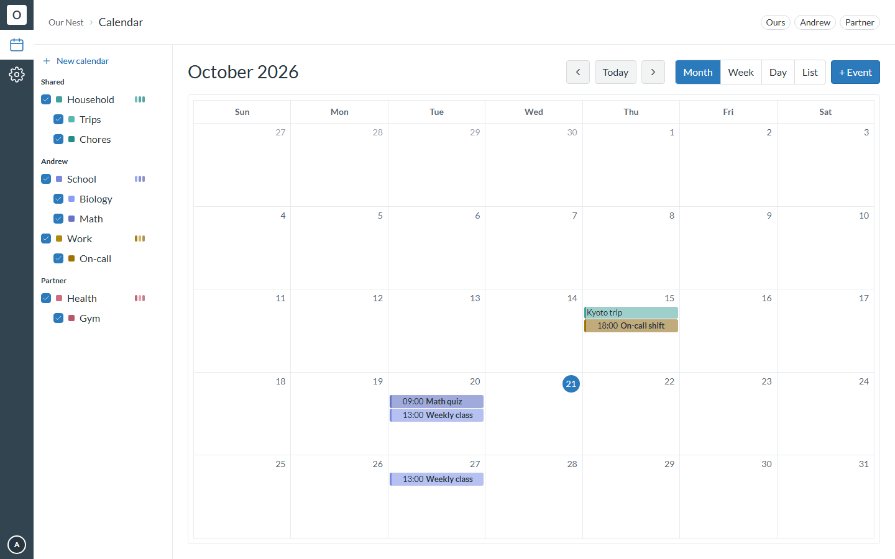
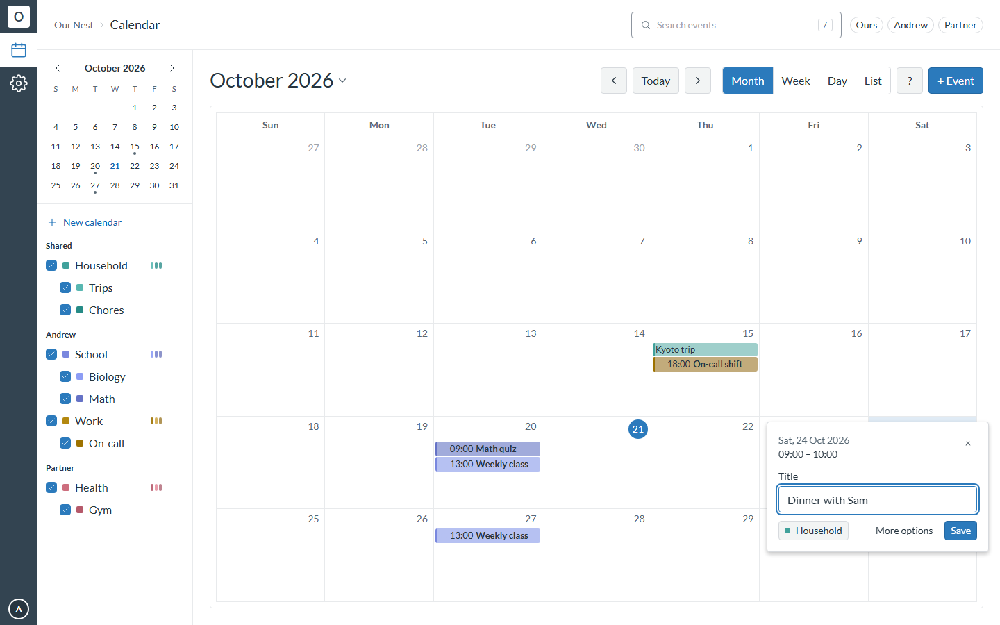
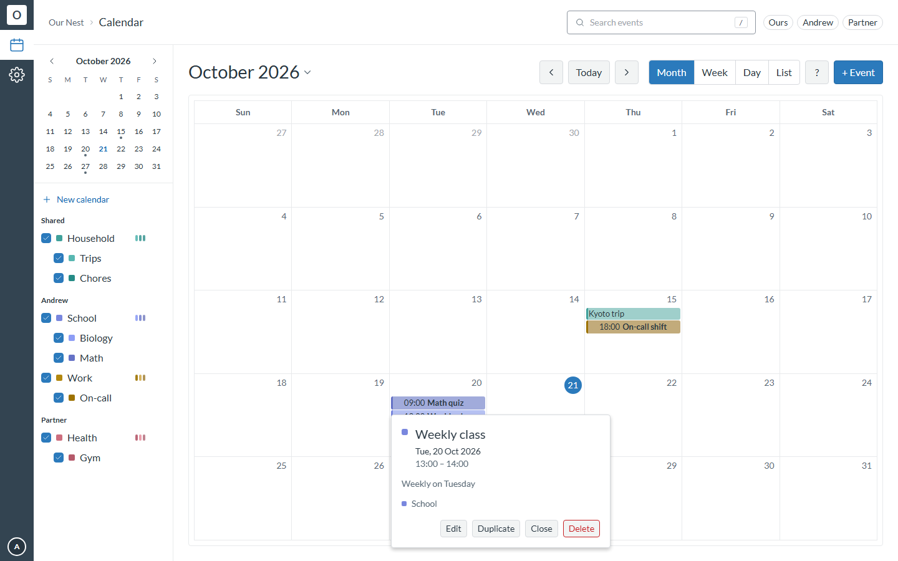
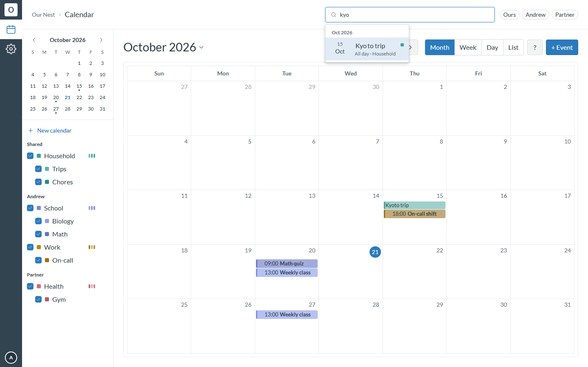
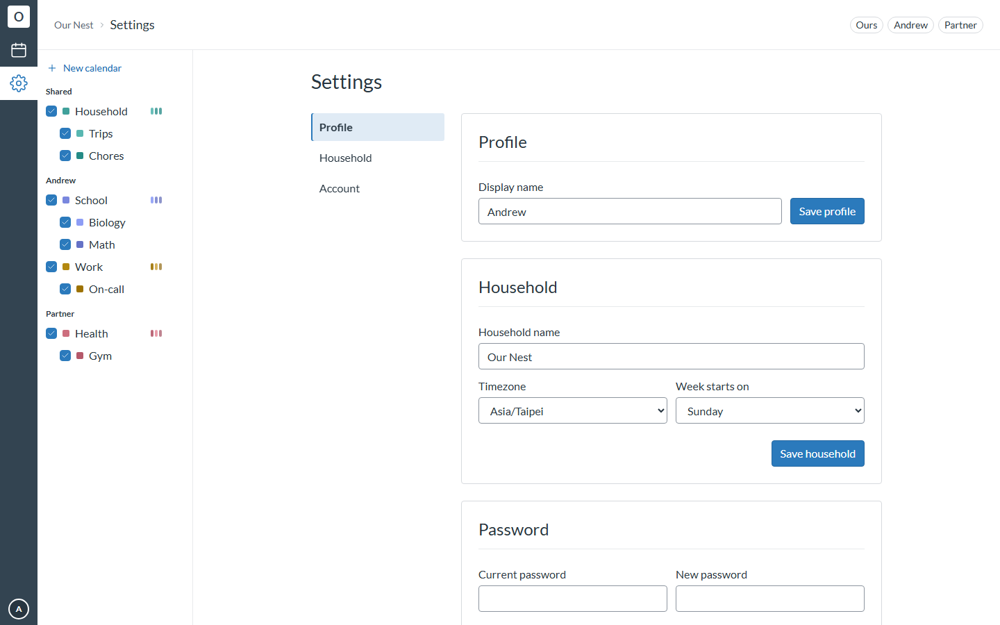
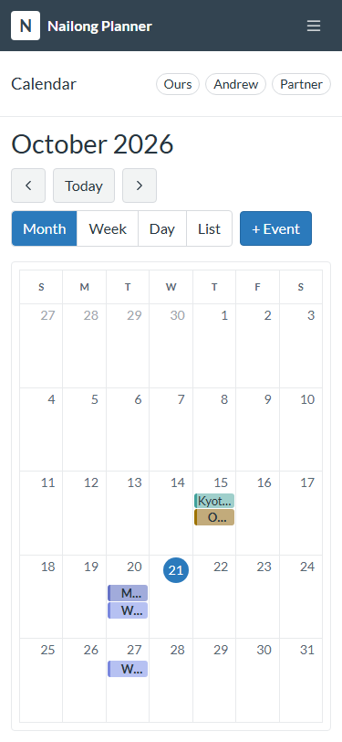
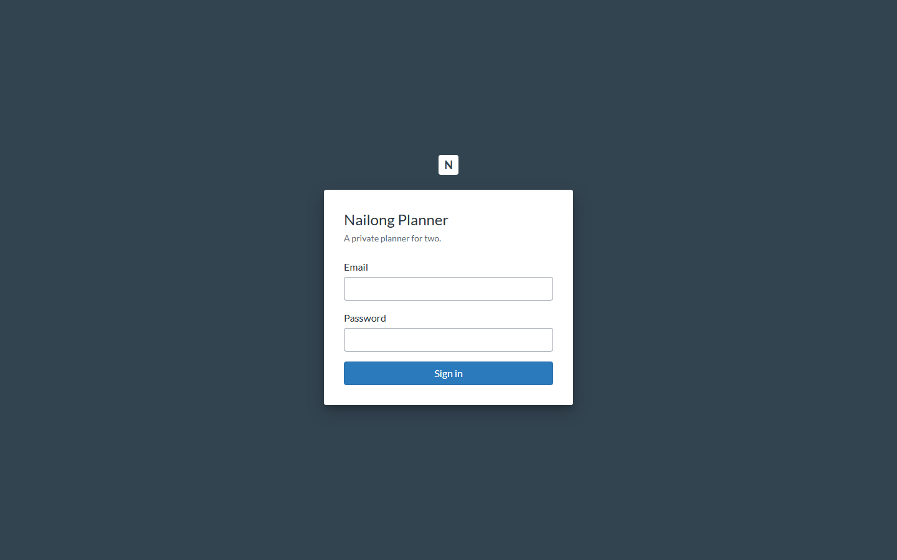

# Nailong Planner

[](https://github.com/andrewhmir/nailong-planner/actions/workflows/ci.yml)
[](https://github.com/andrewhmir/nailong-planner/actions/workflows/codeql.yml)
[](LICENSE)
[](.nvmrc)

A small, self-hosted planner for exactly **two people** — a shared household
calendar with a nested, shade-inheriting calendar hierarchy, wearing the visual
language of Canvas LMS: a dark global rail, a breadcrumb bar, and a course-style
navigation panel — Lato type, Canvas blue, and 3–6px radii throughout.

The calendar borrows Google Calendar's model — several colour-coded calendars,
per-calendar visibility, click-and-drag events, and the daily loops people
already know: click a day to quick-create, click an event for details, `/` to
search, `z` to undo — and adds a **two-level hierarchy**: sub-calendars render in
shades of their parent's colour, so "School" reads as one family while "Math" and
"Biology" stay distinguishable.

One shared household, two accounts, no public sign-up. Everything is visible to
both; a per-calendar **view-only** flag protects a calendar its owner would
rather not have edited.



<details>
<summary>Quick create (day click, range drag or Shift+C)</summary>



</details>

<details>
<summary>Event details</summary>



</details>

<details>
<summary>Search</summary>



</details>

<details>
<summary>Settings page</summary>



</details>

<details>
<summary>Phone (agenda view — the Auto default)</summary>



</details>

<details>
<summary>Sign-in page</summary>



</details>

> There is no hosted demo — the app is meant to be self-hosted for a single
> household. All screenshots above use the seeded demo data from
> `scripts/seed-test-db.mts`, not real household data.

## Features

- **A roadmap in the rail** — Calendar and Tasks are live; Today
  (`Coming in v0.3.0`), Notes and Focus sit greyed in the nav rail. Each opens a
  short "what's coming" panel naming its release and what it will do, so the
  roadmap is part of the app instead of a document nobody reads. Only the next
  version is ever promised; everything after it says `Planned`.
- **Tasks, captured and triaged** — `Shift+K` captures anything from any screen;
  `/tasks` buckets it into Inbox · Today · Week · Someday, then shows it as a
  dense grouped list or a status board: drag a card between To do and In progress
  (or into Done/Dropped with "show closed" on), or capture straight into a
  column. Rows and cards edit their status (including the new **In progress**
  state), priority, dates and list inline, and clicking one opens a right-hand
  slide-over for the title, notes and checklist. Lists in the sidebar show their
  active-task counts and carry a one-click quick add. The keyboard does the rest
  (`j`/`k` to move, `1`–`3` to schedule, `4` to move to another list, `x` to
  complete, `Enter` to open the panel, `z` to undo). Lists sit in the same nested
  tree as calendars and can be private, shared or view-only, with the same
  two-person rules; a scheduled task shows on the calendar as a read-only chip,
  and dragging a row onto the sidebar mini month plans it onto that day.
- **Google-Calendar-shaped daily loops** — a day/slot click, a range drag or
  `Shift+C` opens a quick-create bubble (Enter saves, "More options" escalates to
  the full editor); clicking an event opens anchored details with its repeat
  summary, location link and duplicate action; `/` searches the whole household
  and jumps the grid to the result.
- **Undoable edits** — deletes, moves, resizes and creates render optimistically
  and are undoable from the toast or with `z` / `Ctrl+Z`; a failed drag snaps
  back.
- **Per-user preferences** — 12/24-hour time, default view (`Auto` = agenda on
  phones, month on desktop), week numbers, keyboard shortcuts and default event
  calendar, applied immediately from Settings → Calendar and stored per user.
- **Keyboard-first** — Google Calendar's keys (`c`, `Shift+C`, `/`, `t`, `g`,
  `j`/`n`, `k`/`p`, `d`/`w`/`m`/`l`, `e`, `Delete`, `z`, `Ctrl/Cmd+Z`, `?`) with
  a shortcut sheet, and no single-key shortcut fires while you are typing.
- **Mini-month and date deep links** — a neutral-dot mini calendar in the
  sidebar, a jump-to-date picker on the toolbar title, and `?date=`/`?event=`
  links that open the matching month and event.
- **Whole month at a glance** — the shell is pinned to the viewport, so the nav
  rail and breadcrumb never scroll away and the month grid always uses the
  height that is left. Week/day hours and long agendas scroll inside the
  calendar panel only; the page itself never scrolls.
- **Nested calendars** — a root calendar owns a hue family; sub-calendars take
  the next unused shade of it (up to 7 children per root). The event dialog's
  calendar picker shows that nesting (expand a root to reveal its children, and
  the list scrolls past 320px), and *display only this calendar* narrows the
  grid to one calendar and assigns new events to it. The sidebar tree folds the
  same way — collapse one root's sub-calendars or a whole Shared/name group
  heading, and the tree remembers what you folded per person.
- **Google-Calendar-style events** — click-drag to create, drag to move, resize,
  all-day and timed events, IANA timezones.
- **Recurring events** — RFC 5545 RRULE, with single-occurrence deletion via
  EXDATEs.
- **Google Calendar import** — Settings → *Import from Google Calendar*: upload
  the `.ics` files from a Google export, preview every calendar's counts and
  warnings, map each one under a new **From Google** calendar of your own or an
  existing one, then commit in one transaction. New import calendars belong to
  the person who imports, so hiding Shared ("Ours") does not hide them.
  Re-importing the same export updates in place (no duplicates) and every import
  can be undone. No OAuth, no Google Cloud project.
- **Two-person permissions** — a per-calendar view-only flag, enforced
  server-side on every write, with sub-calendars inheriting the protection.
- **Private by design** — sign-up disabled, exactly two accounts provisioned,
  TOTP two-factor available, DB-backed sessions.
- **Small footprint** — SQLite in WAL mode, one Docker image, one volume.

## Stack

- **Next.js 16** (App Router, TypeScript, standalone output), React 19, Tailwind CSS 4
- **Canvas LMS design language** — Canvas colour, spacing and type tokens; **Lato** self-hosted from vendored woff2 files (SIL OFL 1.1, [`app/fonts/OFL.txt`](app/fonts/OFL.txt))
- **FullCalendar 7.1.3** (pinned exact) — drag, resize, week numbers, IANA
  timezones — with recurrence expanded by [`rrule`](https://github.com/jkbrzt/rrule)
- **SQLite** (better-sqlite3, WAL) + **Drizzle ORM** with committed SQL migrations
- **Better Auth 1.7** — email + password, sign-up disabled, TOTP two-factor, DB-backed sessions
- **TanStack Query** for client caching, **Zod** for validation
- **Vitest** (unit + integration) and **Playwright** (E2E)

## Quickstart

Requires Node 22+ (see `.nvmrc`).

```bash
npm install

cp .env.example .env.local
# edit .env.local: BETTER_AUTH_SECRET, BETTER_AUTH_URL, SEED_USER_1_*, SEED_USER_2_*

npm run db:migrate      # applies the committed SQL migrations
npm run provision       # creates the household + exactly two accounts
npm run dev             # http://localhost:3000
```

The database file lives at `./data/planner.db` by default and is gitignored.

## Scripts

| Script | What it does |
|---|---|
| `npm run dev` / `build` / `start` | Next.js development / production build / production server |
| `npm test` | Vitest unit + integration suites (in-memory SQLite) |
| `npm run test:e2e` | Seeds `.playwright/test.db`, then runs Playwright |
| `npm run lint` / `typecheck` | ESLint / `tsc --noEmit` |
| `npm run db:generate` / `db:migrate` | Generate a Drizzle migration / apply migrations |
| `npm run provision` | Idempotently create the household and the two accounts |
| `npm run reset-password -- --email x --password y` | Break-glass password reset |
| `npm run backup` | Online SQLite backup, gzipped, keeps the 14 newest |
| `npm run restore-check` | Verifies a backup archive (integrity check + row counts) |
| `npm run ops:bundle` | Builds the plain-JS operator CLIs (`ops/*.mjs`) the Docker image ships |

In CI the same checks run on every pull request and on pushes to `main` and
`feat/**`: lint, typecheck, Vitest, production build, Playwright E2E, plus
CodeQL and Dependabot.

## How the calendar model works

- A **root calendar** owns a hue family and renders at shade 3 of 8.
- A **sub-calendar** inherits its parent's family and takes the next unused shade
  from `[4, 2, 5, 1, 6, 0, 7]` — at most 7 per root. Recolouring the root
  re-shades the whole family automatically.
- **Events** may live on a root or a sub-calendar. Timed events are stored as UTC
  instants; all-day events as local `YYYY-MM-DD` dates (inclusive end), so they
  can never drift a day.
- **Recurring events** store an RFC 5545 RRULE and are edited with Google-style
  controls: interval, weekly day picker, monthly day-of-month or nth weekday, and
  `Never` / `On <date>` / `After N occurrences` ends. A stored rule is sent back
  byte-identical until the repeat controls are touched. Repeating events can be
  changed with Google's three scopes — **This event**, **This and following
  events**, **All events** — from a drag, a resize, the Edit form or Delete. A
  one-off change moves just that occurrence (it becomes an ordinary linked event),
  “this and following” splits the series, and “all events” shifts the whole
  series.
- Every query is scoped to the household, and writes are re-checked server-side
  against the view-only rule.
- **Layout contract**: the app shell owns the viewport (`h-dvh`), `main` owns
  overflow, and the calendar fills the remaining height (`height="100%"` +
  `expandRows`). `tests/e2e/viewport-fit.spec.ts` asserts "no page scroll, whole
  month visible" across eight viewports.

## Deploying

The included Dockerfile builds a standalone image and is set up for a Railway
deployment with a `/data` volume; the same image runs on any container host. The
runtime image contains no `tsx` and no TypeScript sources — first-run
provisioning, backups and password recovery run the bundled CLIs instead
(`railway ssh -- node ops/provision.mjs`), and the entrypoint makes a root-owned
volume writable before dropping to the unprivileged `app` user. See
[`docs/OPERATIONS.md`](docs/OPERATIONS.md) for the environment variables, backups
and recovery. Swapping SQLite for Postgres is possible by replacing the data
layer; SQL access is confined to `lib/services/*` to keep that change contained.

## Documentation

Start with [`docs/README.md`](docs/README.md). The three docs that matter most
day to day:

- **Debugging:** [`docs/DEBUGGING.md`](docs/DEBUGGING.md) — layer map, known traps
  and a symptom → file → command table. Read this before grepping.
- **Components:** [`docs/COMPONENTS/`](docs/COMPONENTS/README.md) — one section
  per source file (purpose, API, side effects, callers, gotchas, tests).
- **Agent rules:** [`AGENTS.md`](AGENTS.md) — docs ship with code;
  `npm run docs:check` fails CI when a source file is undocumented.
- **Changelog:** [`CHANGELOG.md`](CHANGELOG.md) — what shipped in each release.

Historical design specs and plans (never edited):

- Design spec: [`docs/superpowers/specs/2026-10-19-nailong-planner-design.md`](docs/superpowers/specs/2026-10-19-nailong-planner-design.md)
- Canvas redesign spec: [`docs/superpowers/specs/2026-10-20-canvas-ui-redesign-design.md`](docs/superpowers/specs/2026-10-20-canvas-ui-redesign-design.md)
- UX parity design: [`docs/superpowers/specs/2026-10-21-calendar-ux-parity-design.md`](docs/superpowers/specs/2026-10-21-calendar-ux-parity-design.md)
- UX parity implementation plan: [`docs/superpowers/plans/2026-10-21-ux-parity-v0.1.0.md`](docs/superpowers/plans/2026-10-21-ux-parity-v0.1.0.md)
- Implementation plan: [`docs/superpowers/plans/2026-10-19-nailong-planner-v0.1.0.md`](docs/superpowers/plans/2026-10-19-nailong-planner-v0.1.0.md)
- Operations, backups, recovery: [`docs/OPERATIONS.md`](docs/OPERATIONS.md)

## Out of scope for v0.2.1

Reminders and notifications · two-way Google Calendar sync and read-only ICS
subscriptions / export feeds · a 30-day trash bin (undo is session-only) ·
dark mode · PWA · notes, focus and the Today page · more than two users.

## Contributing

Issues and pull requests are welcome — start with
[`CONTRIBUTING.md`](CONTRIBUTING.md) for setup, conventions and the checks CI
runs. Please keep contributions to the spirit of the project: a small,
deliberate, two-person household planner.

This project follows the [Contributor Covenant](CODE_OF_CONDUCT.md).

## Security

Please report vulnerabilities privately via
[GitHub Security Advisories](https://github.com/andrewhmir/nailong-planner/security/advisories/new)
rather than a public issue — see [`SECURITY.md`](SECURITY.md).

## License

[MIT](LICENSE). The bundled Lato font files are licensed under the SIL Open Font
License 1.1 — see [`app/fonts/OFL.txt`](app/fonts/OFL.txt).

## Acknowledgements

- The visual language is a study of [Canvas LMS](https://www.instructure.com/canvas);
  this project is not affiliated with Instructure.
- Type: [Lato](https://www.latofonts.com/) by Łukasz Dziedzic (SIL OFL 1.1).
- Calendar engine: [FullCalendar](https://fullcalendar.io/).
